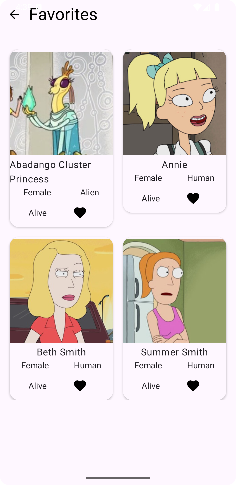
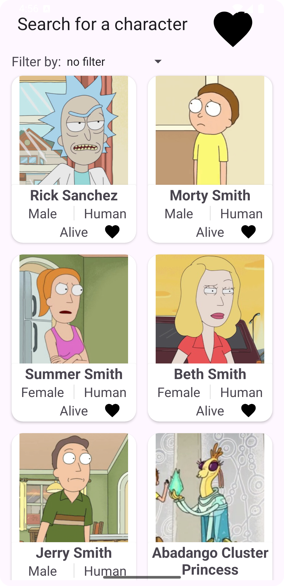
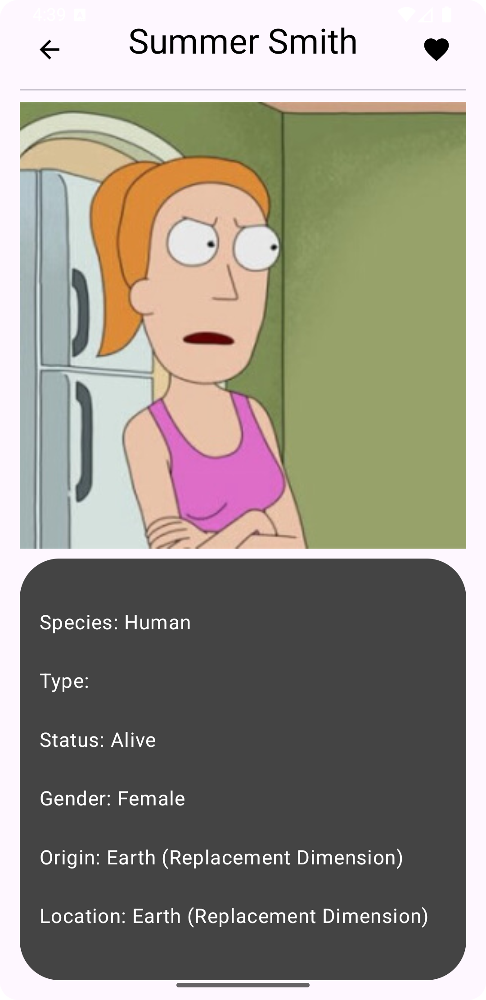
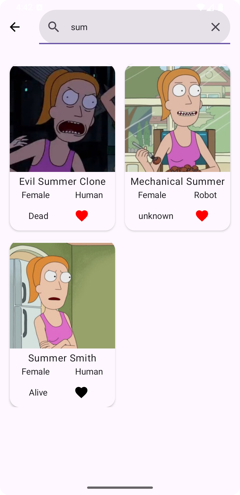

# Rick & Morty App (rmapp)

The Rick & Morty App (rmapp) is an Android application designed to demonstrate best practices in project structure, modularization, and scalable architecture. It aims to be:

- Easy for developers to understand and contribute to
- Support multiple developers working concurrently on the same codebase
- Facilitate testing and maintenance
- Modularized with scalability in mind

---
## App Screenshots

Here are some screenshots of the current app UI:
### Favorites Screen

### Character Feed

### Summer Character

### Search Screen

---
## Architecture & Modularization

The project follows a modular architecture inspired by Google's **Project Nia**, emphasizing clean separation of concerns and scalable design:

- **`app` module**  
  - The main application module  
  - Manages navigation using `NavigationFragment`  
  - Depends on all feature modules

- **Feature modules**  
  Each feature is developed independently:  
  - `character`  
  - `character-feed`  
  - `favorites`  
  - `search`  
  - *(Location and Episode features are planned but not yet developed)*

- **Core modules**  
  Shared libraries containing auxiliary code:  
  - `data` module: Defines repositories used by feature modules  
  - `domain` module: Contains use cases and business logic

---

## Tech Stack & Dependencies

The app leverages modern Android libraries and architecture components, including:

- **UI**: Utilizes both Fragments and Jetpack Compose
- **Paging 3**: Implements efficient data loading with `RemoteMediator` and `RemoteKeys`
- **Dependency Injection**: Dagger Hilt
- **Persistence**: Room database
- **Networking**: Retrofit for API interactions
- **Serialization**: Protocol Buffers (Protobuf)
- **Build & Dependency Management**: Custom Convention Plugins

---

## Build & Configuration

- The project currently includes only the **debug** build variant
- Dependency management is handled via convention plugins for consistency

---

## Known Issues

- The application's UI is currently a "monstrousity" — in need of redesign
- Some features are incomplete or not yet implemented
- Location and Episode features are not developed yet

---

## Future Plans

- Collaborate with designers using Figma to improve the app's UI/UX
- Refine and fix existing UI/UX issues
- Complete development of existing features
- Develop Location and Episode features

---

## Additional Notes

This project serves as a demonstration of scalable, modular Android app architecture following Google's **Project Nia** principles, integrating modern libraries and best practices.

---

Feel free to contribute, report issues, or suggest improvements!

---

**Note:** For more details on dependencies or implementation, refer to the `Nia repository` files and documentation within each module.
